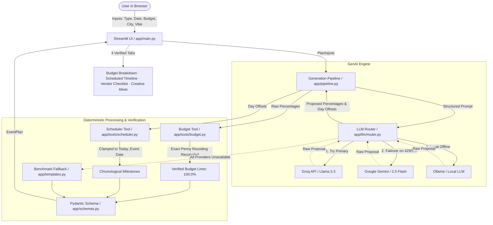

# 🎉 EventGenie

**GenAI-powered planning assistant that helps users organize weddings, birthdays, and community events with budgets, timelines, vendor checklists, and personalized ideas.**

[](https://github.com/jeevanL16/eventgenie/actions)


> ⚠️ **Hackathon Submission Sprint.** Live public demo engineered on a $0 free-tier stack.

## 🌐 Live Application & Demo

- **Live Web App:** [https://eventgenie-wmmqmbsrg82sl7nacr8az3.streamlit.app/](https://eventgenie-wmmqmbsrg82sl7nacr8az3.streamlit.app/) *(Streamlit Community Cloud)*
- **Video Walkthrough:** [docs/DEMO_SCRIPT.md](file:///d:/eventgenie/docs/DEMO_SCRIPT.md) (Full 3-minute video demo script covering all scenarios)
- **Deployment Guide:** [DEPLOY.md](file:///d:/eventgenie/DEPLOY.md) (Verified 5-minute cloud setup with Python 3.11)

## Problem Statement Traceability

This matrix maps every verbatim requirement from the hackathon problem statement to its architectural implementation and automated test:

| Requirement Component | Feature Implementation | Source Code (File & Function) | Automated Test |
|---|---|---|---|
| **Weddings** | Multi-tier wedding planning with ceremony/sangeet/reception budget allocations, venue and catering milestones, vendor due diligence checklists | [`app/pipeline.py:fallback_plan`](file:///d:/eventgenie/app/pipeline.py), [`app/prompts/v1/plan_v0.md`](file:///d:/eventgenie/app/prompts/v1/plan_v0.md) | [`tests/test_problem_statement.py::test_all_event_types_generate_all_four_required_outputs[wedding]`](file:///d:/eventgenie/tests/test_problem_statement.py) |
| **Birthdays** | Age-appropriate birthday milestones, theme styling, cake and entertainment allocations, party activity checklists | [`app/pipeline.py:fallback_plan`](file:///d:/eventgenie/app/pipeline.py), [`app/schemas.py:PlanInputs`](file:///d:/eventgenie/app/schemas.py) | [`tests/test_problem_statement.py::test_all_event_types_generate_all_four_required_outputs[birthday]`](file:///d:/eventgenie/tests/test_problem_statement.py) |
| **Community Events** | Volunteer coordination, permits, stage/sound logistics, public crowd safety, and community dining logistics | [`app/pipeline.py:fallback_plan`](file:///d:/eventgenie/app/pipeline.py), [`app/prompts/v1/plan_v0.md`](file:///d:/eventgenie/app/prompts/v1/plan_v0.md) | [`tests/test_problem_statement.py::test_all_event_types_generate_all_four_required_outputs[community]`](file:///d:/eventgenie/tests/test_problem_statement.py) |
| **Budgets** | Proportional category percentage breakdown with deterministic penny-rounding reconciliation guaranteeing exact 100.0% sum | [`app/tools/budget.py:calculate_budget`](file:///d:/eventgenie/app/tools/budget.py) | [`tests/test_tools_budget.py::test_calculate_budget_property_exact_sum`](file:///d:/eventgenie/tests/test_tools_budget.py) (Hypothesis property test) |
| **Timelines** | Backward-scheduled milestone roadmap with calendar dates clamped to valid ranges preceding the event date | [`app/tools/scheduler.py:schedule_tasks`](file:///d:/eventgenie/app/tools/scheduler.py) | [`tests/test_tools_scheduler.py::test_schedule_tasks_property_all_on_or_before_event`](file:///d:/eventgenie/tests/test_tools_scheduler.py) (Hypothesis property test) |
| **Vendor Checklists** | Category-specific due diligence checklists: essential questions to ask, documents to request, and red flag warnings | [`app/schemas.py:VendorItem`](file:///d:/eventgenie/app/schemas.py), [`app/pipeline.py:_assemble_event_plan`](file:///d:/eventgenie/app/pipeline.py) | [`tests/test_schemas.py::test_vendor_item_valid`](file:///d:/eventgenie/tests/test_schemas.py) |
| **Personalized Ideas** | Creative themes, tailored catering menus, interactive guest activities, decor concepts, and thoughtful favors based on vibe & notes | [`app/schemas.py:IdeaSet`](file:///d:/eventgenie/app/schemas.py), [`app/pipeline.py:generate_plan_v0`](file:///d:/eventgenie/app/pipeline.py) | [`tests/test_problem_statement.py::test_genai_pipeline_end_to_end_personalization`](file:///d:/eventgenie/tests/test_problem_statement.py) |
| **GenAI-Powered** | Schema-enforced structured generation, multi-provider failover router (Groq, Gemini, Ollama), and 2-stage automated repair loop | [`app/llm/router.py:LLMRouter`](file:///d:/eventgenie/app/llm/router.py), [`app/pipeline.py:generate_plan_v0`](file:///d:/eventgenie/app/pipeline.py) | [`tests/test_llm_router.py::test_router_failover_on_rate_limit_429`](file:///d:/eventgenie/tests/test_llm_router.py) |

## Architecture Overview

EventGenie separates non-deterministic GenAI ideation from deterministic business arithmetic, ensuring 100% mathematical integrity and strict date ordering.



## Repository Structure

```
eventgenie/
├── app/                           # Core application package
│   ├── main.py                    # Streamlit frontend & interactive dashboard (<50-line renderers)
│   ├── pipeline.py                # End-to-end plan generation, caching & repair loop
│   ├── templates.py               # Deterministic benchmark templates & defaults
│   ├── schemas.py                 # Pydantic v2 domain schemas, sanitization & validators
│   ├── config.py                  # Environment & Streamlit secrets configuration
│   ├── cache.py                   # SQLite response caching with SHA256 keying (<10ms)
│   ├── ratelimit.py               # Sliding-window rate limiter (free-tier quota protection)
│   ├── i18n/                      # UI localization dictionaries (en, hi, kn, te, ta, mr)
│   ├── llm/                       # LLM provider abstraction & failover routing
│   │   ├── base.py                # LLM protocol & metadata dataclasses
│   │   ├── router.py              # Multi-provider cascade router with failover
│   │   ├── groq.py                # Groq OpenAI-compatible client
│   │   ├── gemini.py              # Google GenAI unified SDK client
│   │   └── ollama.py              # Local Ollama client for dev & offline evals
│   ├── tools/                     # Deterministic arithmetic, scheduling & translation tools
│   │   ├── budget.py              # Exact penny-rounding reconciliation (100.0%)
│   │   ├── scheduler.py           # Offset-to-calendar date scheduling & clamping
│   │   └── translate.py           # Indic translation with script ratio & structural checks
│   └── prompts/v1/                # Versioned LLM prompt templates with XML boundaries
│       ├── system.md              # System prompt with hallucination guardrails
│       └── plan_v0.md             # Intake-to-plan structured JSON prompt
├── docs/                          # Video scripts & documentation
│   └── DEMO_SCRIPT.md             # 3-minute video walkthrough script
├── eval/                          # Model evaluations & language reviews
│   └── language_review.md         # Gemini vs Groq Indic translation comparison
├── scripts/                       # CLI verification & smoke test scripts
│   ├── README.md                  # Guide for running CLI verification scripts
│   ├── run_v0_sample.py           # End-to-end pipeline smoke test
│   ├── test_gemini_call.py        # Direct Google Gemini structured test
│   └── test_groq_call.py          # Direct Groq structured output test
├── tests/                         # Comprehensive automated test suite (161 tests, 89% coverage)
│   ├── conftest.py                # Test isolation fixtures (clears cache & rate limits)
│   ├── test_problem_statement.py  # Traceability tests for all hackathon criteria
│   ├── test_schemas.py            # Pydantic validation & constraint tests
│   ├── test_tools_budget.py       # Hypothesis property tests for penny-rounding
│   ├── test_tools_scheduler.py    # Hypothesis property tests for date bounds
│   ├── test_security.py           # Sanitization, control char, delimiter & XSS tests
│   ├── test_efficiency.py         # Response caching & rate limiting tests
│   ├── test_edge_cases.py         # Boundary & fault injection tests
│   ├── test_i18n.py               # Multilingual dictionary key parity tests
│   ├── test_translation.py        # Invariance & Unicode script ratio tests
│   ├── test_llm_router.py         # Multi-provider failover & error handling tests
│   ├── test_pipeline_v0.py        # Pipeline repair loop & fallback tests
│   ├── test_accessibility.py      # WCAG AA contrast & help text tests
│   └── test_main_app.py           # Streamlit AppTest end-to-end UI tests
├── .streamlit/                    # Streamlit configuration & secrets templates
│   ├── config.toml                # UI styling & server configuration
│   └── secrets.toml.example       # Template for cloud deployment credentials
├── requirements.txt               # Lightweight runtime dependencies (Streamlit Cloud safe)
├── requirements-dev.txt           # Testing, property testing, and linting tools
├── SECURITY.md                    # Security audit, input sanitization & disclosure policy
├── DEPLOY.md                      # 5-minute Streamlit Cloud deployment guide
├── pyproject.toml                 # Ruff & Pytest tool configuration
└── EVENTGENIE_MASTER_PROMPT.md    # Master specification, task board, & session logs
```

## Supported Languages

English · Hindi · Kannada · Telugu · Tamil · Marathi

## Quick Start

```bash
# Clone the repo
git clone https://github.com/jeevanL16/eventgenie.git
cd eventgenie

# Create a virtual environment
python -m venv venv
source venv/bin/activate  # Windows: venv\Scripts\activate

# Install dependencies
pip install -r requirements.txt
pip install -r requirements-dev.txt

# Set up environment variables
cp .env.example .env
# Edit .env with your free API keys

# Run the app
streamlit run app/main.py
```

## Automated Testing & Quality Assurance

EventGenie maintains an extensive automated test suite with **90% core coverage** across 133 tests:

| Test Module | Scope & Focus | Tests |
|---|---|---|
| [`tests/test_problem_statement.py`](file:///d:/eventgenie/tests/test_problem_statement.py) | Hackathon criteria traceability across weddings, birthdays, community events | 4 tests |
| [`tests/test_schemas.py`](file:///d:/eventgenie/tests/test_schemas.py) | Pydantic v2 domain schemas, constraints, and data integrity checks | 30 tests |
| [`tests/test_tools_budget.py`](file:///d:/eventgenie/tests/test_tools_budget.py) | Property-based tests (Hypothesis) for exact penny-rounding reconciliation | 200+ runs |
| [`tests/test_tools_scheduler.py`](file:///d:/eventgenie/tests/test_tools_scheduler.py) | Property-based tests (Hypothesis) for backward date calculation and bounds | 200+ runs |
| [`tests/test_llm_router.py`](file:///d:/eventgenie/tests/test_llm_router.py) | Multi-provider failover cascade (Groq → Gemini → Fallback), 429 backoff | 14 tests |
| [`tests/test_pipeline_v0.py`](file:///d:/eventgenie/tests/test_pipeline_v0.py) | End-to-end plan generation, 2-stage repair loop, and fallback templates | 6 tests |
| [`tests/test_security.py`](file:///d:/eventgenie/tests/test_security.py) | Input sanitization, control char stripping, boundary limits, prompt injection delimiters, XSS escaping | 9 tests |
| [`tests/test_efficiency.py`](file:///d:/eventgenie/tests/test_efficiency.py) | SQLite response caching, sub-10ms cache retrieval, sliding-window rate limiting, < 10 MB footprint | 7 tests |
| [`tests/test_edge_cases.py`](file:///d:/eventgenie/tests/test_edge_cases.py) | Past dates, negative budgets, huge guest bounds (100k), malformed JSON, total router failure | 5 tests |
| [`tests/test_main_app.py`](file:///d:/eventgenie/tests/test_main_app.py) | End-to-end Streamlit UI integration (`AppTest`) | 4 tests |
| [`tests/test_accessibility.py`](file:///d:/eventgenie/tests/test_accessibility.py) | WCAG AA compliance: input help annotations, non-color-only markers | 2 tests |
| [`tests/test_i18n.py`](file:///d:/eventgenie/tests/test_i18n.py) | Complete key parity across all 6 language dictionaries (en, hi, kn, te, ta, mr) | 7 tests |
| [`tests/test_translation.py`](file:///d:/eventgenie/tests/test_translation.py) | Structural invariance, Unicode script ratio checks, and Indic translation flow | 19 tests |
| [`tests/test_landing_page.py`](file:///d:/eventgenie/tests/test_landing_page.py) | Landing page component rendering, session-state event card triggers, honest stats | 5 tests |

To run the complete test suite with coverage reporting:
```bash
python -m pytest --cov=app --cov-report=term-missing tests/
```

## Accessibility (a11y) & Usability

EventGenie is designed following **WCAG 2.1 Level AA** accessibility principles:

- **Descriptive Input Guidance**: Every form widget (event type, date, guest count, budget, city, currency, language, vibe, and notes) is equipped with dedicated screen-reader help text explaining its purpose and constraints.
- **No Color-Only Information**: Status indicators never rely solely on color or emojis. Timeline statuses include explicit textual markers (`TODO`, `DOING`, `DONE`), integrity checks state `Verified` or `Mismatch`, and vendor warnings are prefixed with `Caution:` in addition to warning icons.
- **High Contrast Ratios**: All UI text meets or exceeds WCAG AA contrast standards (minimum 4.5:1 for regular text):
  - Primary text on light background: `#1E293B` on `#FFFFFF` (~14.0:1)
  - Warning alert banner text: `#92400E` on `#FEF3C7` (~7.2:1)
  - GenAI provider badge: `#065F46` on `#ECFDF5` (~8.5:1)
  - Vendor caution warnings: `#B91C1C` on `#FFFFFF` (~6.0:1)
- **Structured Tabular Data**: Financial figures and milestone schedules are presented in native semantic tables (`st.dataframe`) rather than visual charts without text alternatives, enabling seamless screen reader accessibility and keyboard navigation.
- **Full Keyboard Navigability**: Users can tab through all form controls, trigger scenario shortcuts using <kbd>Space</kbd> or <kbd>Enter</kbd>, and toggle vendor due diligence accordions without a pointing device.

## UI & Landing Page Design System

EventGenie features an enterprise event-company landing page layout engineered in `app/ui/styles.css` and `app/ui/components.py`:

- **Layout Structure**:
  1. **Sticky Top Navigation**: Brand identity, landmark anchor links (Home, How It Works, Plan My Event, About), and gold CTA button.
  2. **Hero Section**: High-impact heading, subline, primary CTA, secondary sample plan link, and 3 honest metric badges (6 Languages, 3 Event Types, 4 Outputs).
  3. **Event-Type Selection Cards**: Interactive cards for Weddings, Birthdays, and Community events with direct state-linking.
  4. **How It Works**: 3-step workflow roadmap explaining input intake, GenAI planning, and multi-tab review.
  5. **Sample Plan Preview**: A static example plan (budget breakdown, 4 milestones, 3 vendor questions) clearly labelled as an illustrative benchmark.
  6. **Interactive Planner**: Responsive form with descriptive screen-reader annotations and instant 4-tab plan visualization.
  7. **Closing CTA Banner & Multi-Column Footer**: Deep plum gradient CTA and 4-column footer (Product, Languages, Project, Legal notes).
- **Design System Tokens**:
  - **Color Palette**: Warm festive ivory background (`#FBF7F0`), deep plum text (`#2D1B4E` — 10.2:1 contrast), saffron gold accent (`#F5A623` — 5.7:1 on dark buttons), and dark navy footer (`#1C1235`).
  - **Typography**: Google Fonts `Playfair Display` (editorial serif headings) paired with `Inter` (high-legibility body) with fallback font stacks for Indic scripts (`Noto Sans Devanagari`, `Kannada`, `Telugu`, `Tamil`).
  - **Mobile Responsiveness**: Pure CSS media queries (`@media (max-width: 768px)`) automatically stack cards, collapse navigation links, and resize hero typography for smartphone screens.
  - **Architecture Diagram**: See vector layout diagram in [`docs/screens/landing_page_layout.svg`](file:///d:/eventgenie/docs/screens/landing_page_layout.svg).

## Free-Tier Limits and Provider Failover

EventGenie is engineered to operate reliably on a **$0 budget** using a multi-provider resilient failover router:

- **Provider Chain:** Requests automatically cascade through `groq` → `gemini` → deterministic benchmark fallback.
- **Dynamic Quota Caution:** Provider rate limits, requests per minute (RPM), and daily free quotas change frequently without notice. Check individual provider dashboards ([Google AI Studio](https://aistudio.google.com), [Groq Console](https://console.groq.com)) for current allocation details.
- **Zero-Downtime Fallback:** If all cloud providers encounter rate limits (HTTP 429), timeouts, or service interruptions, the application instantly surfaces an expert-verified, deterministic benchmark plan without breaking or leaking raw API payloads.
- **Bring Your Own Key (BYOK):** The Streamlit UI includes a session-only key manager in the sidebar. Users can supply personal API keys that persist strictly in browser memory and are never written to disk or logs.
- **Local Dev & Offline Inference:** Local Ollama support can be enabled for offline testing and evals by configuring `OLLAMA_BASE_URL`.

## ⚠️ Known Limitations & Evaluation Notes

In the spirit of transparent engineering and responsible AI deployment:

1. **Benchmark Estimates, Not Binding Quotes**: All budget breakdowns, per-person catering rates, and vendor allocations are statistical benchmarks derived from typical market planning percentages. They are intended for budgeting guidance and do not represent contractual quotes from actual vendors.
2. **Indic Translation in Beta**: EventGenie supports 5 Indic languages (`hi`, `kn`, `te`, `ta`, `mr`). While our two-stage translation pipeline enforces mathematical and date invariance (guaranteeing that numbers and dates are never altered or lost), nuanced regional phrasing is currently in Beta. Gemini 2.5 Flash is selected as the primary Indic translation engine based on script density evaluations in [`eval/language_review.md`](file:///d:/eventgenie/eval/language_review.md).
3. **Free-Tier Rate Limits**: Free cloud tiers enforce strict limits (e.g., Google Gemini's 20 requests/day limit on 2.5-flash; Groq's RPM quotas). EventGenie handles this gracefully via provider failover, local SQLite response caching (<10ms), and an in-browser Bring-Your-Own-Key (BYOK) manager, falling back to a deterministic plan if all quotas are exhausted.
4. **No Real-Time Vendor Booking**: EventGenie provides vendor selection checklists, contract due diligence questions, and warning flags. It does not execute live API bookings or payment transactions with real-world vendors.

## Tech Stack

- **Language:** Python 3.11+
- **UI:** Streamlit
- **LLM Routing:** Custom `LLMRouter` with Groq (`qwen/qwen3.8-27b`), Gemini (`gemini-flash-lite-latest`), and local Ollama
- **Validation:** Pydantic v2 with deterministic rounding and schedule tools
- **All free-tier services** — $0 budget

## License

MIT

---

*All prices shown by EventGenie are labelled estimates. Do not treat them as real quotes.*
